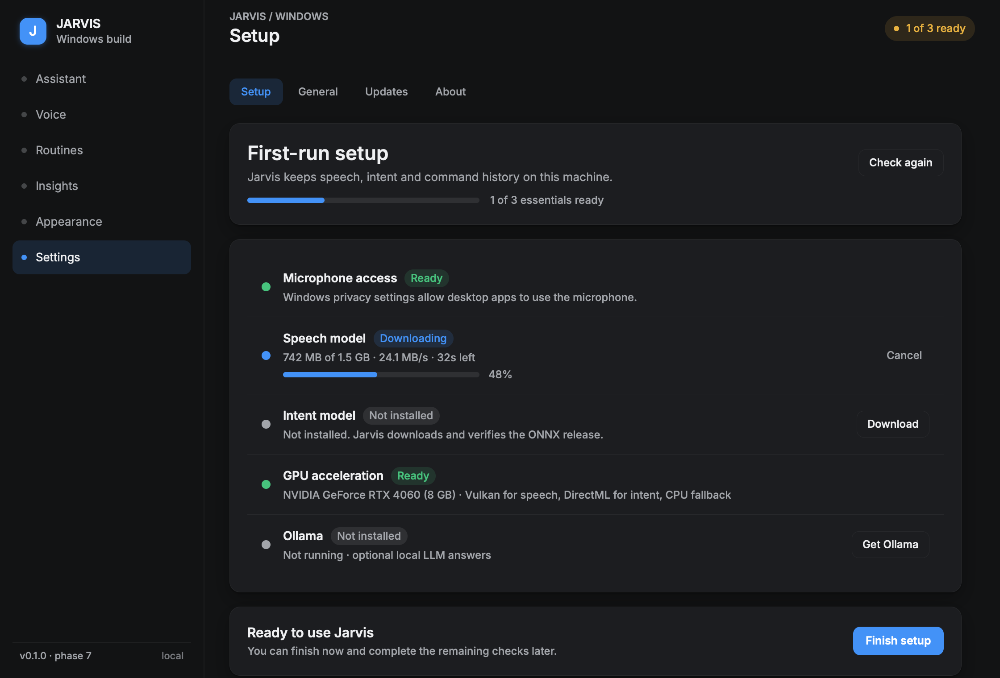
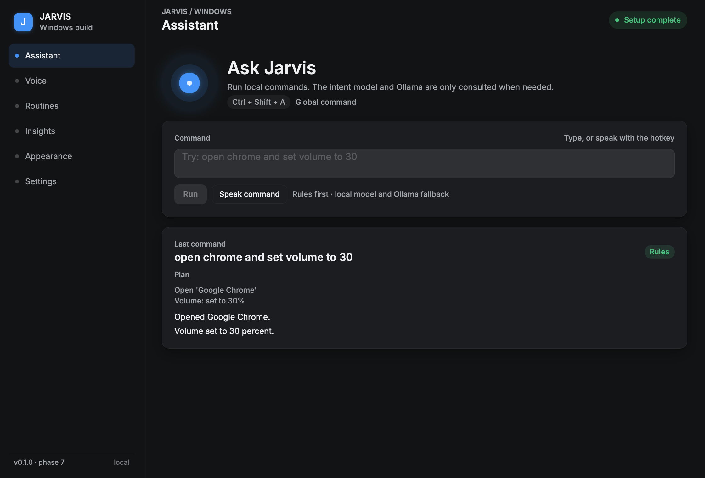
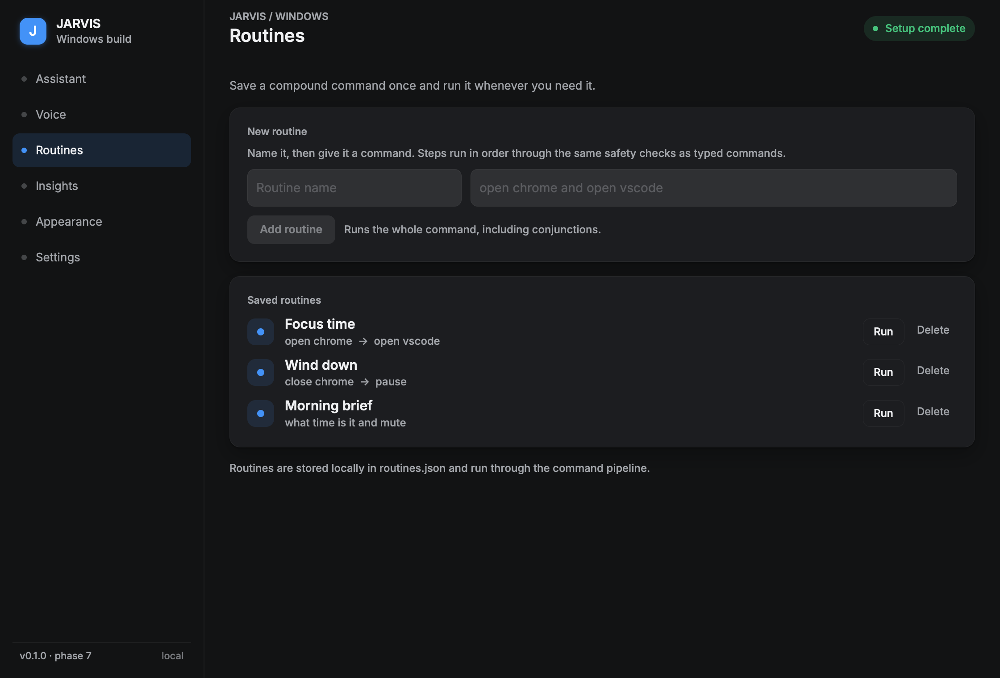
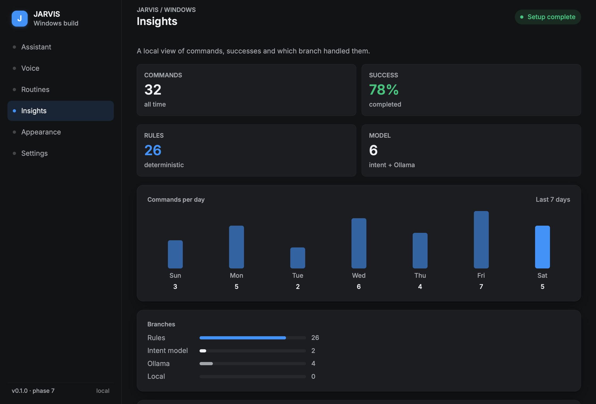

# Jarvis for Windows

A native Windows port of [Jarvis](https://github.com/CHITESHVARUN10/jarvuss), the
local-first macOS voice assistant. Speech, intent and command routing all run on
the machine. No Electron, no Python at runtime, no account.

The macOS project is cloned into `jarvuss/` for reference and is ignored by git.

## Status

**Phase 7 complete: code signing, verified auto-update and signed release distribution.**

- Rune (native GPU-rendered Rust UI) application window with navigation.
- First-run setup with essentials progress, status chips and per-item fixes.
- Windows microphone privacy probe, DXGI GPU inventory and a settings deep link.
- Speech model downloads with resumable 8 MiB range requests, `.part` recovery,
  quarantine of invalid files and full size/ggml/SHA-256 verification.
- Intent releases resolved from the pinned Hugging Face commit, validated against
  the release manifest, downloaded with per-file checksums, and activated as
  immutable version directories with `current.json` / `last-good.json`.
- Warm-up loading for both models: Whisper on a dedicated worker, DirectML-first
  ONNX Runtime on Windows, and CPU fallback for both.
- Native audio capture at the device format, downmixed and resampled to 16 kHz
  mono, with a live level meter and a 300 s recording cap.
- Voice-activity gating, 6 s chunks with 1 s overlap, live partial transcripts,
  and overlap dedupe/stitch before the final transcript.
- Persistent Whisper worker: lazy load, English greedy decoding, and idle unload
  after 300 s.
- Default `Ctrl+Shift+D` dictation hotkey (configurable), Voice page
  Start/Stop/Cancel controls, and transcript Copy.
- Automatic paste at the cursor with clipboard snapshot/restore; elevated windows
  that block synthetic input fall back to leaving the transcript on the clipboard.
- Assistant command bar and default `Ctrl+Shift+A` command dictation.
- Deterministic command planner ported from the macOS rust-core, with Windows app,
  settings, folder, file and safety policy.
- Local learned intent engine for unknown non-questions: DirectML first, CPU
  fallback, strict JSON action mapping and 300 s idle unload.
- Optional Ollama planner/answer fallback with a short localhost timeout.
- Windows actions for apps, URLs/search, volume, media transport, settings panes,
  folders, file creation/search/open/reveal, time/date/battery/WiFi/volume.
- Pre-execution safety: destructive/elevated commands blocked, installs previewed,
  protected system paths denied, app-close allowlist and http(s)-only links.
- Routines: named compound commands stored locally, shown as ordered steps, and
  run through the same planner and safety checks.
- Insights: command totals, success rate, branch split and a seven-day chart,
  recorded locally when a command finishes.
- Windows tray menu (Open, Dictate, Command, Settings, Quit) with close-to-tray.
- Launch at login through the user's Run key, and configurable dictation/command
  hotkeys recorded from a chord.
- Persisted settings (theme, accent, setup, hotkeys, startup, tray) with atomic
  writes.
- Per-user NSIS installer, portable zip and MSIX package built from one release
  executable, with SHA-256 checksums.
- Release workflow on `v*` tags that builds and uploads all Windows artifacts.
- Fat-LTO release profile, a 4 MiB rotating command log, bounded command history
  and the existing model idle unload.
- Signed releases: `packaging/windows/sign.ps1` signs the executable, installer
  and MSIX with timestamping and rewrites `SHA256SUMS.txt` over the signed bytes.
- In-app updates: GitHub release discovery, channel filtering, checksum-checked
  downloads, mandatory Authenticode verification and optional publisher pinning
  before the installer is offered.
- Cross-platform dev preview: the same app runs on macOS for UI work.
- GitHub Actions on Windows and macOS: formatting, clippy, tests, build; a
  tag-driven Windows release workflow that signs when the certificate secret is
  configured.

## UI












The screenshots use demo statuses, a demo transcript, demo routines and demo
insights; the real app fills them from the Windows probes, microphone, command
planner and model workers.

## Stack

| Concern | Choice |
| --- | --- |
| Interface | [Rune](https://github.com/anomalyco/rune), pinned by revision |
| Speech to text | whisper.cpp via `whisper-rs`, `ggml-large-v3-turbo` |
| Dictation | cpal/WASAPI, 16 kHz mono, VAD, 6 s chunks with 1 s overlap |
| Commands | Ported deterministic planner + t5 intent + optional Ollama |
| Windows actions | `ShellExecute`, WASAPI volume, media keys, `ms-settings`, file search |
| Routines and insights | local JSON stores, planner replay, local aggregation |
| Tray and startup | Rune `Shell_NotifyIcon` tray, `HKCU\...\Run` |
| Hotkeys and paste | Win32 `RegisterHotKey` + clipboard/`SendInput` |
| Packaging | NSIS, MakeAppx/MSIX, portable zip, SHA-256 release artifacts |
| Intent | fine-tuned t5-small, int8 ONNX from [Hugging Face](https://huggingface.co/chitesh12545/jarvis-intent-t5-small) |
| Speech acceleration | Vulkan feature build (NVIDIA, AMD, Intel iGPUs), CPU fallback |
| Intent acceleration | DirectML by default on Windows, CPU fallback |
| Local answers | Ollama, optional |
| Runtime | Rust only; Python stays in training tooling |

## Build

Windows prerequisites: Rust 1.97+, the MSVC build tools (the default
`x86_64-pc-windows-msvc` toolchain), CMake, and LLVM/libclang for the native
model bindings.

```powershell
cargo run -p jarvis-app
cargo test --workspace
```

The default build is CPU for speech. Build the GPU speech path with Vulkan (this
also needs the Vulkan SDK, including `glslc`):

```powershell
cargo build --release -p jarvis-app --features gpu-vulkan
```

The intent runtime is self-contained on Windows: `ort` downloads its pinned,
DirectML-enabled ONNX Runtime distribution at build time and links it into the
binary. The engine tries DirectML first and falls back to CPU automatically.

If Windows cannot create symlinks (Developer Mode is off), the build places
`DirectML.dll` only in `target\debug`; copy it to `target\debug\deps` before
running tests. CI does this automatically. Packaging puts `DirectML.dll` beside
the executable when it can find it; without it the intent engine falls back to
CPU.

## Release artifacts

Windows packaging needs NSIS and the Windows SDK:

```powershell
choco install nsis -y
pwsh packaging/windows/build.ps1 -Version 0.1.0
```

The script writes `dist\` with:

- `Jarvis-<version>-x64-setup.exe` — per-user NSIS installer.
- `Jarvis-<version>-x64-portable.zip` — `jarvis.exe` plus `DirectML.dll`.
- `Jarvis-<version>-x64.msix` — full-trust MSIX package.
- `SHA256SUMS.txt`.

The installer writes to `%LOCALAPPDATA%\Programs\Jarvis`, adds Start menu and
optional desktop shortcuts, and asks before deleting user data during uninstall.
The target machine needs the Microsoft Visual C++ 2015–2022 Redistributable
(x64); the installer warns if `vcruntime140.dll` is missing. To sign, run
`pwsh packaging/windows/sign.ps1 -Version 0.1.0 -Certificate <pfx>`; it signs the
executable, installer and MSIX with an RFC 3161 timestamp, verifies the result
and rewrites `SHA256SUMS.txt` so the published hashes cover the signed bytes.
Pushing a `v*` tag runs `.github/workflows/release.yml`, which repeats the build,
signs when `WINDOWS_SIGNING_CERTIFICATE` and `WINDOWS_SIGNING_PASSWORD` are
configured, and uploads everything to a GitHub release. Bump the workspace
`Cargo.toml` version before tagging; the packaging script rejects a mismatch.

## Updates

Settings → Updates checks GitHub releases at most once a day after start-up.
Stable accepts final releases; Prerelease also accepts beta and release-candidate
tags. Downloads:

1. Require the asset to be listed in the release's `SHA256SUMS.txt`.
2. Stream into `updates/` with a size cap, retrying from scratch on a mismatch.
3. Verify the SHA-256, then the Authenticode signature and publisher pin.
4. Only then offer **Install and restart**, which starts the signed installer and
   quits Jarvis so it can replace `jarvis.exe`.

Unsigned artifacts are refused unless `JARVIS_ALLOW_UNSIGNED_UPDATE=1` is set for
development. Pin releases to one signer with `JARVIS_UPDATE_PUBLISHER` (a
certificate subject or publisher name). A manual release from an unsigned
workflow run is manual-install only. Update checks and outcomes are written to
the command log.

On macOS the UI preview runs with the same command. Microphone and GPU probes
report that they are Windows-only, and the app uses `JarvisWindows` as its data
directory so it never touches a real macOS Jarvis install. Real intent warm-up on
macOS needs an ONNX Runtime dylib via `JARVIS_ORT_DYLIB`.

Live checks download real models or use the microphone and are not part of CI:

```powershell
# Intent (206 MB): install, warm-up, then check "open chrome" -> app.open.
# On macOS set JARVIS_ORT_DYLIB to an ONNX Runtime 1.31 dylib.
cargo test -p jarvis-models --test live_intent -- --ignored --nocapture

# Speech (1.6 GB).
cargo test -p jarvis-models --test live_speech -- --ignored --nocapture

# Microphone capture only (no model needed).
cargo test -p jarvis-speech microphone_capture_smoke -- --ignored --nocapture
```

Headless renders for UI review (debug builds include Rune's tooling):

```powershell
cargo run -p jarvis-app -- --snap setup.png --scene setup
cargo run -p jarvis-app -- --snap downloading.png --scene downloading
cargo run -p jarvis-app -- --snap voice.png --scene voice
cargo run -p jarvis-app -- --snap ready.png --scene ready
cargo run -p jarvis-app -- --snap routines.png --scene routines
cargo run -p jarvis-app -- --snap insights.png --scene insights
cargo run -p jarvis-app -- --snap settings.png --scene settings
cargo run -p jarvis-app -- --snap appearance.png --scene appearance
```

## Data layout

On Windows everything lives under `%LOCALAPPDATA%\Jarvis`:

```text
%LOCALAPPDATA%\Jarvis\
  settings.json                     theme, accent, hotkeys, startup, setup
  routines.json                     saved named commands
  insights.json                     local command totals and daily buckets
  logs\commands.log                 timestamped app and setup log
  logs\commands.log.1               previous log after the 4 MiB rotation
  update-check.json                 last successful update check
  updates\                          verified installer downloads
  models\
    ggml-large-v3-turbo.bin         speech model (about 1.5 GB)
    ggml-large-v3-turbo.bin.part    resumable partial download
    intent\
      current.json                  active release receipt
      last-good.json                last successfully warmed release
      download-<commit>\            resumable staging for a release
      versions\<commit>-<nonce>\    immutable model files + manifest
```

Overrides for testing and custom installs: `JARVIS_DATA_DIR`,
`JARVIS_STT_MODEL_DIR`, `JARVIS_INTENT_MODEL_DIR`.

## Models

Speech: `ggml-large-v3-turbo.bin`, pinned to a whisper.cpp Hugging Face revision,
exactly 1,624,555,275 bytes and SHA-256
`1fc70f774d38eb169993ac391eea357ef47c88757ef72ee5943879b7e8e2bc69`.

Intent: `chitesh12545/jarvis-intent-t5-small`, exported as int8 ONNX
(`encoder_model_quantized.onnx` + `decoder_model_merged_quantized.onnx`).

Download behaviour:

- The speech model resumes from the actual partial size, validates
  `Content-Range`, restarts safely if a server ignores `Range`, and only
  publishes the file after size, ggml header and SHA-256 checks pass.
- The intent model pins `main` to a commit once, verifies the release manifest,
  requires the expected files and license notices, and checks every file before
  atomically activating a `versions\<commit>-<nonce>` directory.
- Cancelling keeps the partial/staging files for a later resume.
- A release that fails validation never replaces a working install; a locally
  newer version is kept instead of being downgraded.
- After a successful download the model is loaded and warmed up. Whisper decodes
  one second of silence; the intent model must return a valid plan for `pause`.
- DirectML is attempted first on Windows for intent; Vulkan is attempted first
  for speech when the `gpu-vulkan` feature is compiled in. Both fall back to CPU.

## Dictation

Press `Ctrl+Shift+D` (the default) anywhere, speak, then press it again. You can
also use the Voice page's Start/Stop buttons, and change the chord in Settings →
General. The window does not need focus.

- The microphone opens at its native format; channels are averaged and a stateful
  resampler produces 16 kHz mono.
- 20 ms RMS frames gate silence. A chunk must contain at least six voiced frames
  (120 ms) before it reaches Whisper.
- Audio is transcribed in 6 s chunks with a 1 s overlap while you speak. The
  stitched transcript is deduplicated before it becomes final.
- A fresh Whisper decode is used per chunk. The model loads on first use and is
  unloaded after 300 s of inactivity.
- The final transcript is pasted into the foreground window with `Ctrl+V`. The
  previous text clipboard is restored after the paste if it was not replaced.
- Windows blocks synthetic input into elevated apps (UIPI). In that case Jarvis
  leaves the transcript on the clipboard and says so in the UI.
- The recording cap is 300 s; reaching it stops capture and transcribes what was
  recorded.

Limitations: clipboard restore preserves text only; there is no floating
dictation pill yet. Hotkeys are configurable in Settings → General.

## Commands

Type a command in the Assistant bar or press `Ctrl+Shift+A` (the default), speak,
and press it again. The command hotkey needs the speech model; typed commands work
without it. No window focus is required, so commands can be spoken while another
app is active. Both global hotkeys are configurable in Settings → General.

Routing is deliberately local-first:

1. Clean and validate the utterance; run the safety checks.
2. Use deterministic rules for common apps, volume, media transport, info, URLs,
   searches, settings pages, folders and files.
3. For unknown non-questions, ask the local t5 intent model and strictly map its
   JSON action list; plans below 0.75 confidence fall through.
4. If nothing local decides it, ask Ollama to plan; if it returns an answer rather
   than an action, show that answer.

The result card names the branch that decided it: `Rules`, `Intent model` or
`Ollama`.

Supported now:

- Open known apps and close most of them (Chrome, Edge, Firefox, Brave, Arc,
  Spotify, WhatsApp, VS Code, Windows Terminal, File Explorer, Notepad, Calculator,
  Settings, Paint, Task Manager, GitHub Desktop). Explorer and command prompts are
  protected from close.
- Open http(s) URLs, open a URL in a named browser, Google/YouTube searches, and
  Windows settings pages by name.
- Volume set/increase/decrease, mute/unmute, and media play/pause/next/previous
  through the Windows media keys.
- Open known folders; create a file or folder in Documents (never overwrite);
  count/list/newest/oldest/largest/total-size file queries; search by name or
  content; open or reveal results in Explorer.
- Time, date, day, month, year, battery, Wi-Fi, and current volume.

Deferred to later phases:

- Display brightness/contrast/resolution.
- Playing a named song or playlist, liked songs, and shuffle control.
- Opening a project workspace by name.
- Installing apps.

Safety: destructive and elevated commands are blocked; install commands are
preview-only and disabled; protected Windows paths are denied; app close uses a
known-image allowlist; links are http(s)-only; file creation cannot escape
Documents and cannot overwrite.

The intent model loads lazily on the first unknown non-question, tries DirectML
and falls back to CPU, and is unloaded after 300 s idle. Ollama is optional; when
it is running, the planner uses `qwen2.5:1.5b-instruct` with a 20 s planning
timeout and a 30 s answer timeout. Without Ollama, unknown free-form questions
return a clear local-only message instead of silence.

## Routines

The Routines page saves a name plus a compound command in `routines.json`. Steps
split on the same conjunctions as speech commands and are shown in order. Run
sends the command through the normal planner, safety checks and result card. You
can also type or speak the routine's name (or `run <name>`). Delete removes it
immediately. Routines are local and never uploaded.

## Insights

Insights records one event when a command finishes, including failed plans:
total, succeeded/failed, the deciding branch (Rules, Intent model, Ollama or
Local), and a daily bucket. The page shows totals, success rate, a seven-day
chart and the branch split. History is capped at 90 days in `insights.json`; no
command text, audio or model request is stored or sent anywhere.

## Performance bounds

- The release profile uses fat LTO, one codegen unit, `opt-level = 3` and symbol
  stripping. Artifacts are built by the release workflow, not on every check.
- Command history keeps the ten newest results; older file action data is
  dropped with them.
- The command/setup log rotates to `commands.log.1` at 4 MiB, so continuous
  command logging cannot grow without bound.
- Insight history is capped at 90 days; routines at 50 entries.
- The intent engine unloads after 300 s idle; Whisper has its own idle unload.
- The UI is event-driven: the tray and background workers wake Rune through its
  waker instead of polling.

## Tray, startup and hotkeys

On Windows the app keeps a tray icon with Open Jarvis, Dictate, Command, Settings
and Quit. Closing the window leaves Jarvis running in the tray by default; turn
that off in Settings → General to make close quit. The tray reopens the window
with its state intact.

Launch at login writes the current executable to
`HKCU\Software\Microsoft\Windows\CurrentVersion\Run`. It launches the window
normally; there is no silent-background launch yet.

Settings → General has Record buttons for both global hotkeys. Choose a modifier
(Ctrl, Shift, Alt or Win) plus a letter, digit, F1–F24 or Space; Escape cancels.
The new chord is registered before it is saved, the other hotkey cannot collide,
and a failed registration leaves the old one working. Defaults are
`Ctrl+Shift+D` for dictation and `Ctrl+Shift+A` for commands.

## Phases

| Phase | Scope | Status |
| --- | --- | --- |
| 1 | Workspace, Rune shell, first-run setup, Windows permission/GPU probes, CI | Done |
| 2 | Model manager: download, resume, verify, activate, warm up, GPU providers | Done |
| 3 | Audio capture, VAD, Whisper transcription, dictation hotkey, text insertion | Done |
| 4 | Command planner/actions, Windows app/URL/volume/media/files/settings | Done |
| 5 | Routines, insights, tray, startup, hotkey settings, UI parity | Done |
| 6 | Packaging (MSIX/NSIS), release artifacts, performance hardening | Done |
| 7 | Code signing, auto-update, signed MSIX distribution | Done |
| 8 | Silent-background login launch, floating dictation pill, insights export | Planned |

Architecture and porting notes: [ARCHITECTURE.md](ARCHITECTURE.md).

## Notes

- `vendor/` contains Rune's patched `winit`, `wgpu-hal`, `parley_engine` and
  `accesskit_windows` crates. Rune requires apps that embed it to apply the same
  patches; see [vendor/README.md](vendor/README.md).
- Node is installed in CI for developer tooling only. The shipped application has
  no Node or Python dependency.
