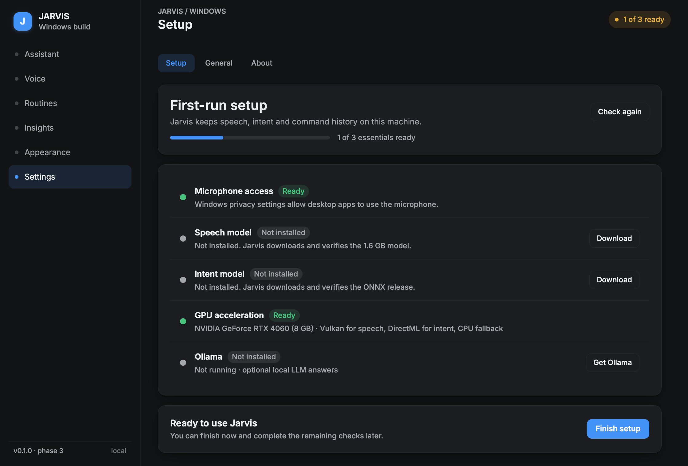
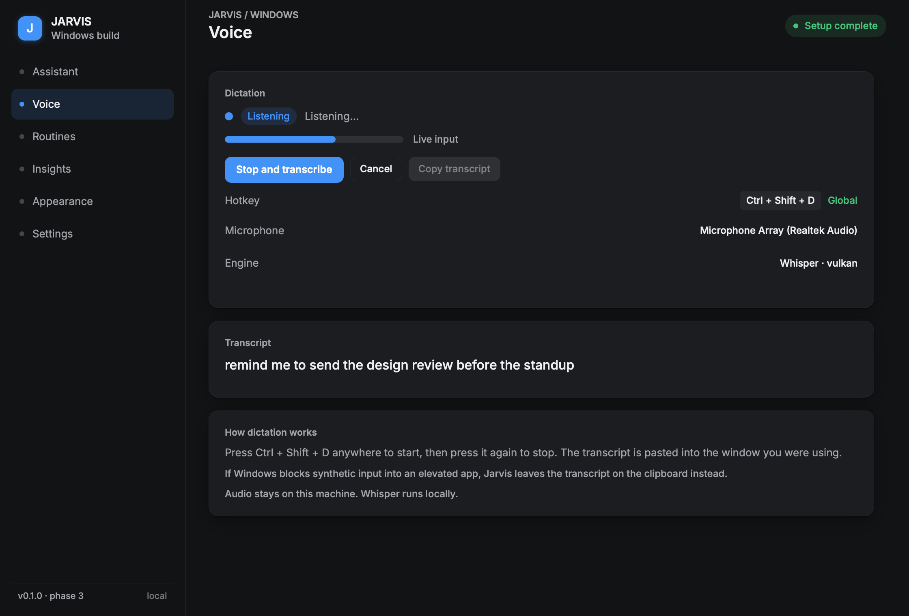
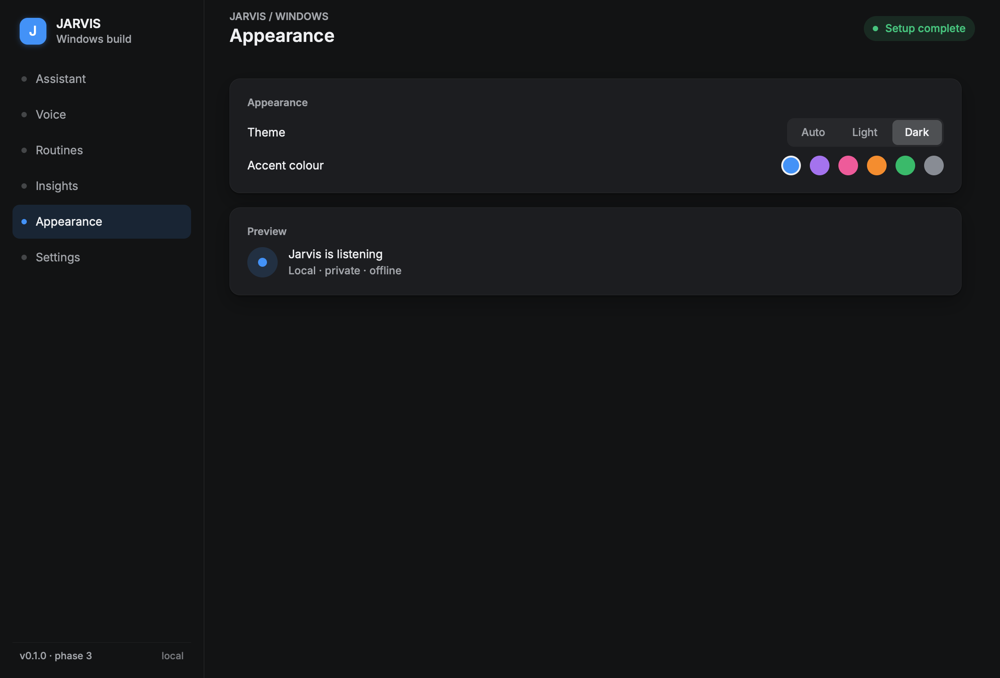

# Jarvis for Windows

A native Windows port of [Jarvis](https://github.com/CHITESHVARUN10/jarvuss), the
local-first macOS voice assistant. Speech, intent and command routing all run on
the machine. No Electron, no Python at runtime, no account.

The macOS project is cloned into `jarvuss/` for reference and is ignored by git.

## Status

**Phase 3 complete: local dictation.**

- Rune (native GPU-rendered Rust UI) application window with navigation.
- First-run setup with essentials progress, status chips and per-item fixes.
- Windows microphone privacy probe, DXGI GPU inventory and a settings deep link.
- Speech model downloads with resumable 8 MiB range requests, `.part` recovery,
  quarantine of invalid files and full size/ggml/SHA-256 verification.
- Intent releases resolved from the pinned Hugging Face commit, validated against
  the release manifest, downloaded with per-file checksums, and activated as
  immutable version directories with `current.json` / `last-good.json`.
- Warm-up loading for both models: Whisper on a dedicated worker, DirectML-first
  ONNX Runtime on Windows, and CPU fallback for both.
- Native audio capture at the device format, downmixed and resampled to 16 kHz
  mono, with a live level meter and a 300 s recording cap.
- Voice-activity gating, 6 s chunks with 1 s overlap, live partial transcripts,
  and overlap dedupe/stitch before the final transcript.
- Persistent Whisper worker: lazy load, English greedy decoding, and idle unload
  after 300 s.
- Global `Ctrl+Shift+D` dictation hotkey, Voice page Start/Stop/Cancel controls,
  and transcript Copy.
- Automatic paste at the cursor with clipboard snapshot/restore; elevated windows
  that block synthetic input fall back to leaving the transcript on the clipboard.
- Optional Ollama probe with a short localhost timeout.
- Persisted settings (theme, accent, setup completion) with atomic writes.
- Timestamped command log under the data directory.
- Cross-platform dev preview: the same app runs on macOS for UI work.
- GitHub Actions on Windows and macOS: formatting, clippy, tests, build.

## UI









The screenshots use demo statuses and a demo transcript; the real app fills them
from the Windows probes, microphone and model worker.

## Stack

| Concern | Choice |
| --- | --- |
| Interface | [Rune](https://github.com/anomalyco/rune), pinned by revision |
| Speech to text | whisper.cpp via `whisper-rs`, `ggml-large-v3-turbo` |
| Dictation | cpal/WASAPI, 16 kHz mono, VAD, 6 s chunks with 1 s overlap |
| Hotkey and paste | Win32 `RegisterHotKey` + clipboard/`SendInput` |
| Intent | fine-tuned t5-small, int8 ONNX from [Hugging Face](https://huggingface.co/chitesh12545/jarvis-intent-t5-small) |
| Speech acceleration | Vulkan feature build (NVIDIA, AMD, Intel iGPUs), CPU fallback |
| Intent acceleration | DirectML by default on Windows, CPU fallback |
| Local answers | Ollama, optional |
| Runtime | Rust only; Python stays in training tooling |

## Build

Windows prerequisites: Rust 1.97+, the MSVC build tools (the default
`x86_64-pc-windows-msvc` toolchain), CMake, and LLVM/libclang for the native
model bindings.

```powershell
cargo run -p jarvis-app
cargo test --workspace
```

The default build is CPU for speech. Build the GPU speech path with Vulkan (this
also needs the Vulkan SDK, including `glslc`):

```powershell
cargo build --release -p jarvis-app --features gpu-vulkan
```

The intent runtime is self-contained on Windows: `ort` downloads its pinned,
DirectML-enabled ONNX Runtime distribution at build time and links it into the
binary. The engine tries DirectML first and falls back to CPU automatically.

If Windows cannot create symlinks (Developer Mode is off), the build places
`DirectML.dll` only in `target\debug`; copy it to `target\debug\deps` before
running tests. CI does this automatically.

On macOS the UI preview runs with the same command. Microphone and GPU probes
report that they are Windows-only, and the app uses `JarvisWindows` as its data
directory so it never touches a real macOS Jarvis install. Real intent warm-up on
macOS needs an ONNX Runtime dylib via `JARVIS_ORT_DYLIB`.

Live checks download real models or use the microphone and are not part of CI:

```powershell
# Intent (206 MB). On macOS set JARVIS_ORT_DYLIB to an ONNX Runtime 1.31 dylib.
cargo test -p jarvis-models --test live_intent -- --ignored --nocapture

# Speech (1.6 GB).
cargo test -p jarvis-models --test live_speech -- --ignored --nocapture

# Microphone capture only (no model needed).
cargo test -p jarvis-speech microphone_capture_smoke -- --ignored --nocapture
```

Headless renders for UI review (debug builds include Rune's tooling):

```powershell
cargo run -p jarvis-app -- --snap setup.png --scene setup
cargo run -p jarvis-app -- --snap downloading.png --scene downloading
cargo run -p jarvis-app -- --snap voice.png --scene voice
cargo run -p jarvis-app -- --snap ready.png --scene ready
cargo run -p jarvis-app -- --snap appearance.png --scene appearance
```

## Data layout

On Windows everything lives under `%LOCALAPPDATA%\Jarvis`:

```text
%LOCALAPPDATA%\Jarvis\
  settings.json                     theme, accent, setup completion
  logs\commands.log                 timestamped app and setup log
  models\
    ggml-large-v3-turbo.bin         speech model (about 1.5 GB)
    ggml-large-v3-turbo.bin.part    resumable partial download
    intent\
      current.json                  active release receipt
      last-good.json                last successfully warmed release
      download-<commit>\            resumable staging for a release
      versions\<commit>-<nonce>\    immutable model files + manifest
```

Overrides for testing and custom installs: `JARVIS_DATA_DIR`,
`JARVIS_STT_MODEL_DIR`, `JARVIS_INTENT_MODEL_DIR`.

## Models

Speech: `ggml-large-v3-turbo.bin`, pinned to a whisper.cpp Hugging Face revision,
exactly 1,624,555,275 bytes and SHA-256
`1fc70f774d38eb169993ac391eea357ef47c88757ef72ee5943879b7e8e2bc69`.

Intent: `chitesh12545/jarvis-intent-t5-small`, exported as int8 ONNX
(`encoder_model_quantized.onnx` + `decoder_model_merged_quantized.onnx`).

Download behaviour:

- The speech model resumes from the actual partial size, validates
  `Content-Range`, restarts safely if a server ignores `Range`, and only
  publishes the file after size, ggml header and SHA-256 checks pass.
- The intent model pins `main` to a commit once, verifies the release manifest,
  requires the expected files and license notices, and checks every file before
  atomically activating a `versions\<commit>-<nonce>` directory.
- Cancelling keeps the partial/staging files for a later resume.
- A release that fails validation never replaces a working install; a locally
  newer version is kept instead of being downgraded.
- After a successful download the model is loaded and warmed up. Whisper decodes
  one second of silence; the intent model must return a valid plan for `pause`.
- DirectML is attempted first on Windows for intent; Vulkan is attempted first
  for speech when the `gpu-vulkan` feature is compiled in. Both fall back to CPU.

## Dictation

Press `Ctrl+Shift+D` anywhere, speak, then press it again. You can also use the
Voice page's Start/Stop buttons. The window does not need focus.

- The microphone opens at its native format; channels are averaged and a stateful
  resampler produces 16 kHz mono.
- 20 ms RMS frames gate silence. A chunk must contain at least six voiced frames
  (120 ms) before it reaches Whisper.
- Audio is transcribed in 6 s chunks with a 1 s overlap while you speak. The
  stitched transcript is deduplicated before it becomes final.
- A fresh Whisper decode is used per chunk. The model loads on first use and is
  unloaded after 300 s of inactivity.
- The final transcript is pasted into the foreground window with `Ctrl+V`. The
  previous text clipboard is restored after the paste if it was not replaced.
- Windows blocks synthetic input into elevated apps (UIPI). In that case Jarvis
  leaves the transcript on the clipboard and says so in the UI.
- The recording cap is 300 s; reaching it stops capture and transcribes what was
  recorded.

Limitations in this phase: the hotkey is fixed; clipboard restore preserves text
only; there is no floating dictation pill or tray overlay yet (Phase 5).

## Phases

| Phase | Scope | Status |
| --- | --- | --- |
| 1 | Workspace, Rune shell, first-run setup, Windows permission/GPU probes, CI | Done |
| 2 | Model manager: download, resume, verify, activate, warm up, GPU providers | Done |
| 3 | Audio capture, VAD, Whisper transcription, dictation hotkey, text insertion | Done |
| 4 | Command planner/actions, Windows app/URL/volume/media/files/settings | Next |
| 5 | Routines, insights, tray, startup, hotkey settings, UI parity | Planned |
| 6 | Packaging (MSIX/NSIS), release artifacts, performance hardening | Planned |

Architecture and porting notes: [ARCHITECTURE.md](ARCHITECTURE.md).

## Notes

- `vendor/` contains Rune's patched `winit`, `wgpu-hal`, `parley_engine` and
  `accesskit_windows` crates. Rune requires apps that embed it to apply the same
  patches; see [vendor/README.md](vendor/README.md).
- Node is installed in CI for developer tooling only. The shipped application has
  no Node or Python dependency.
